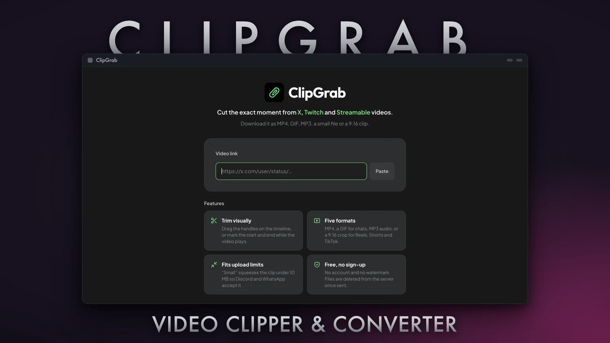
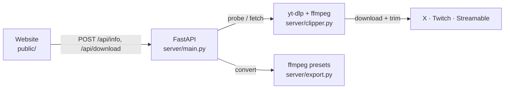

# ClipGrab

Cut the exact moment from an **X**, **Twitch** or **Streamable** video, and download it as an MP4, GIF, MP3, a Discord-sized file or a vertical 9:16 clip. Free, no sign-up, no watermark.

**Live at [clipgrab.aravarun.in](https://clipgrab.aravarun.in)**

[](docs/demo.mp4)

▶ [Watch the demo video](docs/demo.mp4)

## Why it's useful

The usual way to share part of a video is to screen-record it. That's slow (recording runs in real time), it catches the player's buttons, and it loses quality. ClipGrab cuts the original file instead, so a 10-second clip takes a few seconds and looks exactly like the source.

| You want to… | Use |
| --- | --- |
| Reply in Slack, Discord or a GitHub issue with the moment that matters | **GIF** |
| Repost a Twitch highlight to Reels, Shorts or TikTok | **9:16** |
| Send a clip on Discord or WhatsApp without a "file too large" error | **Small** (under 10 MB) |
| Keep a quote, a song snippet or a podcast moment | **MP3** |
| Keep the clip at full quality, or pick a smaller resolution | **MP4** + quality |

## Features

- **Visual trimmer**: the video plays on the page. Drag the two handles on the timeline, or play to a point and click **Mark**. **Play clip** previews exactly what you'll get.
- **Export presets**: MP4, GIF, MP3, Small (under 10 MB) and vertical 9:16. Each is one ffmpeg command in [`server/export.py`](server/export.py).
- **Quality picker**: every resolution the site offers, with its file size.
- **Recent clips**: your last six clips, kept in your browser only (no account, nothing stored on the server).
- **Shareable links**: `clipgrab.aravarun.in/?url=<video link>` opens ClipGrab with the link filled in.

## Supported platforms

| Platform | Links like |
| --- | --- |
| X / Twitter | `x.com/user/status/…`, `twitter.com/…` |
| Twitch clips | `clips.twitch.tv/…`, `twitch.tv/user/clip/…` |
| Streamable | `streamable.com/…` |

Other sites are refused with a clear message. YouTube, Vimeo, Instagram and Reddit block downloads from cloud servers (or require a login), so they can't work on a free hosted backend.

## Project structure

```
server/
  main.py        API routes and request checks (link, times, preset, quality)
  clipper.py     supported sites, yt-dlp options, look up + download + trim, error messages
  export.py      the GIF, MP3, Small and 9:16 presets, one ffmpeg command each
  __main__.py    runs the API and website together locally
public/          the website: index.html, app.js, styles.css, assets/
docs/            architecture diagram, demo video and preview image
pyproject.toml   dependencies, plus the Vercel entrypoint
vercel.json      tells Vercel this is a FastAPI app
```

## How it works



The same diagram is in [`docs/architecture.excalidraw`](docs/architecture.excalidraw) (open it at [excalidraw.com](https://excalidraw.com)).

1. **Look up** (`POST /api/info`): the server checks the link is from a supported site, then asks [yt-dlp](https://github.com/yt-dlp/yt-dlp) for the video's title, length, qualities and a direct video URL, without downloading anything. The page plays that URL straight from the site, so scrubbing costs the server nothing.
2. **Download** (`POST /api/download`): yt-dlp picks the best single-file MP4 at or below the chosen quality and downloads only the selected range. ffmpeg does the cutting.
3. **Convert**: for GIF, MP3, Small or 9:16, one ffmpeg command turns the clip into that format.
4. **Send and clean up**: the file streams back to the browser, then its temp folder is deleted.

Details worth knowing:

- **Why single-file MP4s:** X also offers separate audio and video streams (HLS). yt-dlp can't cut those from a mid-point, which produced empty files, so ClipGrab asks for the single-file version that all three sites offer.
- **How the GIFs look good:** ffmpeg first builds a 256-colour palette from the clip itself, then maps every frame onto it (`palettegen` + `paletteuse`). The default palette makes GIFs blotchy.
- **How "Small" hits 10 MB:** it divides the size budget by the clip's length to get a bitrate, then encodes at that bitrate. Clips already under 10 MB are sent as they are.
- **Why the page hides its address from X:** X's video server refuses to play its videos on other sites when it can see which site is asking, so `index.html` sets `<meta name="referrer" content="no-referrer">`.
- **Where ffmpeg comes from:** Vercel has no ffmpeg installed, so the server uses the copy bundled with the `imageio-ffmpeg` package and puts it on `PATH`.

## API

| Endpoint | Body | Returns |
| --- | --- | --- |
| `POST /api/info` | `{ "url" }` | `platform`, `title`, `uploader`, `thumbnail`, `duration`, `preview` (a playable URL), `qualities` (`height`, `size`) |
| `POST /api/download` | `{ "url", "start"?, "end"?, "preset"?, "height"? }` | the file. `preset` is `mp4` (default), `gif`, `mp3`, `small` or `vertical`; `height` caps the resolution, e.g. `720` |
| `GET /api/health` | | `{ "ok": true }` |

Errors come back as `{ "error": "message for the user" }` with a 4xx or 5xx status. Interactive docs are at `/api/docs`.

## Run locally

Needs [uv](https://docs.astral.sh/uv/).

```bash
uv sync
```

```bash
uv run python -m server
```

Open http://localhost:8000.

## Deploy

Vercel's free plan runs `server/main.py` as a single FastAPI function and serves `public/` from its CDN. Pushing to `main` deploys.

Limits: files over 450 MB are refused, because Vercel functions get 512 MB of disk. GIF, Small and 9:16 re-encode the video, so they take clips of up to 60 seconds to finish inside Vercel's time limit.
