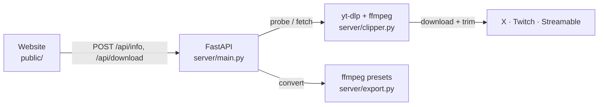

# ClipGrab

Cut the exact moment from an **X**, **Twitch** or **Streamable** video, and download it as an MP4, GIF, MP3, a Discord-sized file or a vertical 9:16 clip. Free, no sign-up, no watermark.

▶ [Watch the demo video](docs/demo.mp4)

## Why it's useful

Platforms like X, Twitch, and Streamable don't let you freely download or clip videos. You can get around this by screen recording, but it's slow, captures player controls, and reduces quality. ClipGrab cuts directly from the original video, letting you create high-quality clips in seconds.

## Features

- **Visual trimmer**: the video plays on the page. Drag the two handles on the timeline, or play to a point and click **Mark**. **Play clip** previews exactly what you'll get.
- **Export presets**: MP4, GIF, MP3, Small (under 10 MB) and vertical 9:16. Each is one ffmpeg command in [`server/export.py`](server/export.py).
- **Quality picker**: every resolution the site offers, with its file size.
- **Recent clips**: your last six clips, kept in your browser only (no account, nothing stored on the server).
- **Shareable links**: `clipgrab.aravarun.in/?url=<video link>` opens ClipGrab with the link filled in.

## Supported platforms

| Platform | Links like |
| --- | --- |
| X / Twitter | `x.com/user/status/…`, `twitter.com/…` |
| Twitch clips | `clips.twitch.tv/…`, `twitch.tv/user/clip/…` |
| Streamable | `streamable.com/…` |

## Project structure

```
server/
  main.py        API routes and request checks (link, times, preset, quality)
  clipper.py     supported sites, yt-dlp options, look up + download + trim, error messages
  export.py      the GIF, MP3, Small and 9:16 presets, one ffmpeg command each
  __main__.py    runs the API and website together locally
public/          the website: index.html, app.js, styles.css, assets/
docs/            architecture diagram, demo video and preview image
pyproject.toml   dependencies, plus the Vercel entrypoint
vercel.json      tells Vercel this is a FastAPI app
```

## How it works



1. **Look up** (`POST /api/info`): the server checks the link is from a supported site, then asks [yt-dlp](https://github.com/yt-dlp/yt-dlp) for the video's title, length, qualities and a direct video URL, without downloading anything. The page plays that URL straight from the site, so scrubbing costs the server nothing.
2. **Download** (`POST /api/download`): yt-dlp picks the best single-file MP4 at or below the chosen quality and downloads only the selected range. ffmpeg does the cutting.
3. **Convert**: for GIF, MP3, Small or 9:16, one ffmpeg command turns the clip into that format.
4. **Send and clean up**: the file streams back to the browser, then its temp folder is deleted.

## API

| Endpoint | Body | Returns |
| --- | --- | --- |
| `POST /api/info` | `{ "url" }` | `platform`, `title`, `uploader`, `thumbnail`, `duration`, `preview` (a playable URL), `qualities` (`height`, `size`) |
| `POST /api/download` | `{ "url", "start"?, "end"?, "preset"?, "height"? }` | the file. `preset` is `mp4` (default), `gif`, `mp3`, `small` or `vertical`; `height` caps the resolution, e.g. `720` |
| `GET /api/health` | | `{ "ok": true }` |

Errors come back as `{ "error": "message for the user" }` with a 4xx or 5xx status. Interactive docs are at `/api/docs`.

## Run locally

Needs [uv](https://docs.astral.sh/uv/).

```bash
uv sync
```

```bash
uv run python -m server
```
