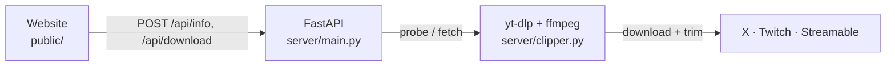

# ClipGrab

Paste a link from **X**, **Twitch** or **Streamable**, pick the moment, and download it as an MP4.

**Live at [clipgrab.aravarun.in](https://clipgrab.aravarun.in)**

- **Clip or download whole**: enter a start and end time (`90`, `1:30` or `0:01:30`), or leave them empty for the full video.
- **Preview first**: as soon as you paste a link, ClipGrab shows the video's title, thumbnail and length.
- **Shareable links**: `clipgrab.aravarun.in/?url=<video link>` opens ClipGrab with the link filled in.

## Supported platforms

| Platform | Links like |
| --- | --- |
| X / Twitter | `x.com/user/status/…`, `twitter.com/…` |
| Twitch clips | `clips.twitch.tv/…`, `twitch.tv/user/clip/…` |
| Streamable | `streamable.com/…` |

Other sites are refused with a clear message. YouTube, Vimeo, Instagram and Reddit block downloads from cloud servers (or require a login), so they can't work on a free hosted backend.

## Project structure

```
server/
  main.py        API routes and request checks (link format, start/end times)
  clipper.py     supported sites, yt-dlp options, download + trim, error messages
  __main__.py    runs the API and website together locally
public/          the website: index.html, app.js, styles.css, assets/
docs/            architecture diagram and demo video
pyproject.toml   dependencies, plus the Vercel entrypoint
vercel.json      tells Vercel this is a FastAPI app
```

## How it works



The same diagram is in [`docs/architecture.excalidraw`](docs/architecture.excalidraw) (open it at [excalidraw.com](https://excalidraw.com)).

1. **Look up** (`POST /api/info`): the server checks the link is from a supported site, then asks [yt-dlp](https://github.com/yt-dlp/yt-dlp) for the video's title, thumbnail and length without downloading it.
2. **Download** (`POST /api/download`): yt-dlp picks the best single-file MP4 the site offers and downloads only the requested time range. ffmpeg does the cutting.
3. **Send and clean up**: the file streams back to the browser, then its temp folder is deleted.

Two details worth knowing:

- **Why single-file MP4s:** X also offers separate audio and video streams (HLS). yt-dlp can't cut those from a mid-point, which produced empty files, so ClipGrab asks for the single-file version that all three sites offer.
- **Where ffmpeg comes from:** Vercel has no ffmpeg installed, so the server uses the copy bundled with the `imageio-ffmpeg` package and puts it on `PATH`.

## API

| Endpoint | Body | Returns |
| --- | --- | --- |
| `POST /api/info` | `{ "url" }` | `platform`, `title`, `uploader`, `thumbnail`, `duration` |
| `POST /api/download` | `{ "url", "start"?, "end"? }` | the MP4 file |
| `GET /api/health` | | `{ "ok": true }` |

Errors come back as `{ "error": "message for the user" }` with a 4xx or 5xx status. Interactive docs are at `/api/docs`.

## Run locally

Needs [uv](https://docs.astral.sh/uv/).

```bash
uv sync
```

```bash
uv run python -m server
```

Open http://localhost:8000.

## Deploy

Vercel's free plan runs `server/main.py` as a single FastAPI function and serves `public/` from its CDN. Pushing to `main` deploys.

Files over 450 MB are refused, because Vercel functions get 512 MB of disk.
