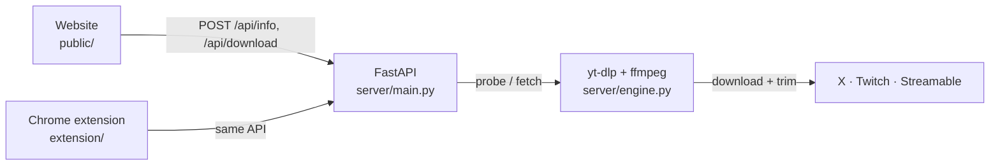

# ClipGrab

Paste a link from **X**, **Twitch** or **Streamable**, pick the moment, and download it as an MP4.

- **Clip or download whole**: enter a start and end time (`90`, `1:30` or `0:01:30`), or leave them empty for the full video.
- **Preview first**: as soon as you paste a link, ClipGrab shows the video's title, thumbnail and length.
- **Chrome extension**: fills in the link from the tab you're on, and downloads through Chrome's download manager.

## Supported platforms

| Platform | Links like |
| --- | --- |
| X / Twitter | `x.com/user/status/…`, `twitter.com/…` |
| Twitch clips | `clips.twitch.tv/…`, `twitch.tv/user/clip/…` |
| Streamable | `streamable.com/…` |

Other sites are refused with a clear message. YouTube, Vimeo, Instagram and Reddit block downloads from cloud servers (or require a login), so they can't work on a free hosted backend.

## How it works



The same diagram is in [`architecture.excalidraw`](architecture.excalidraw) (open it at [excalidraw.com](https://excalidraw.com)).

1. **Look up** (`POST /api/info`): the server checks the link is from a supported site, then asks [yt-dlp](https://github.com/yt-dlp/yt-dlp) for the video's title, thumbnail and length without downloading it.
2. **Download** (`POST /api/download`): yt-dlp picks the best single-file MP4 the site offers and downloads only the requested time range. ffmpeg does the cutting.
3. **Send and clean up**: the file streams back to the browser, then its temp folder is deleted.

Two details worth knowing:

- **Why single-file MP4s:** X also offers separate audio and video streams (HLS). yt-dlp can't cut those from a mid-point, which produced empty files, so ClipGrab asks for the single-file version that all three sites offer.
- **Where ffmpeg comes from:** Vercel has no ffmpeg installed, so the server uses the copy bundled with the `imageio-ffmpeg` package and puts it on `PATH`.

```
server/engine.py   supported sites, yt-dlp options, download + trim, error messages
server/main.py     FastAPI routes and request checks (link format, times)
public/            the website (plain HTML, CSS, JS), served by Vercel's CDN
extension/         the Chrome extension (Manifest V3)
tests/             pytest suite
```

## Run locally

Needs [uv](https://docs.astral.sh/uv/).

```bash
uv sync
```

```bash
uv run python -m server
```

Open http://localhost:8000. Interactive API docs are at http://localhost:8000/api/docs.

## Tests

```bash
uv run pytest
```

These run offline: request checks, which sites are accepted, error messages, and the download route (with yt-dlp faked).

```bash
uv run pytest -m live
```

These download a real 10-second clip from the middle of a video on each platform and check its length.

## API

| Endpoint | Body | Returns |
| --- | --- | --- |
| `POST /api/info` | `{ "url" }` | `platform`, `title`, `uploader`, `thumbnail`, `duration` |
| `POST /api/download` | `{ "url", "start"?, "end"? }` | the MP4 file |
| `GET /api/health` | | `{ "ok": true }` |

Errors come back as `{ "error": "message for the user" }` with a 4xx or 5xx status.

## Chrome extension

1. Download `clipgrab-extension.zip` from the website and unzip it.
2. Open `chrome://extensions`, turn on **Developer mode**, click **Load unpacked** and pick the folder.

To work on it, point `API` at the top of `extension/popup.js` to `http://localhost:8000`. After changing any extension file, rebuild the zip the website serves (a test checks it's up to date):

```bash
cd extension && rm -f ../public/extension/clipgrab-extension.zip && zip -qrXD ../public/extension/clipgrab-extension.zip . -x '.*'
```

## Deploy

Vercel's free plan runs `server/main.py` as a single FastAPI function (configured in `pyproject.toml` and `vercel.json`) and serves `public/` from its CDN. Pushing to `main` deploys.

Files over 450 MB are refused, because Vercel functions get 512 MB of disk.
