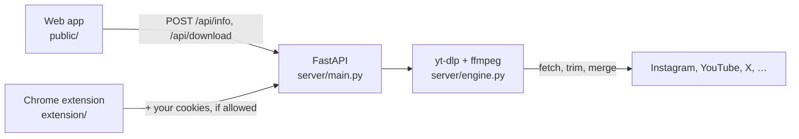

# ClipGrab

Paste a link from Instagram, YouTube, X, Reddit or [1,000+ other sites](https://github.com/yt-dlp/yt-dlp/blob/master/supportedsites.md), pick the moment, and download it.

<video src="https://github.com/user-attachments/assets/6212ee20-2571-4ea4-bcfe-077f26aba9e2" width="100%" controls></video>

- **Clip any link**: reels, stories, posts, tweets, videos. Leave the times empty for the whole thing.
- **Stories and carousels**: every item shows up as a thumbnail; pick the one you want.
- **Photos too**: Instagram photo posts and photo stories download as images.
- **Login-only content**: the Chrome extension can use your own login for a site (only after you allow it), so stories and private posts you can see work too.

## How it works



A fuller diagram is in [`architecture.excalidraw`](architecture.excalidraw) (open it at [excalidraw.com](https://excalidraw.com)).

1. `POST /api/info` asks yt-dlp what a link holds (title, platform, each story or carousel item).
2. `POST /api/download` downloads one item; yt-dlp has ffmpeg cut the range and merge audio and video into an MP4.
3. The file streams back and its temp folder is deleted.

```
server/      FastAPI app (main.py) and the yt-dlp engine (engine.py)
public/      the website, served by Vercel's CDN
extension/   the Chrome extension (MV3)
tests/       pytest suite
```

## Run locally

Needs [uv](https://docs.astral.sh/uv/).

```bash
uv sync
```

```bash
uv run python -m server
```

Open http://localhost:8000. The interactive API docs are at http://localhost:8000/api/docs.

```bash
uv run pytest
```

## API

| Endpoint | Body | Returns |
| --- | --- | --- |
| `POST /api/info` | `{ "url", "cookies"? }` | title, platform, uploader, thumbnail, and `items` (index, kind, thumbnail, duration) |
| `POST /api/download` | `{ "url", "item"?, "start"?, "end"?, "cookies"? }` | the file; times can be `90`, `1:30` or `0:01:30` |

Errors come back as `{ "error", "code" }`. `auth_required` means the site needs a login, which the extension can supply.

## Chrome extension

1. Download `clipgrab-extension.zip` from the website and unzip it.
2. Open `chrome://extensions`, turn on **Developer mode**, click **Load unpacked** and pick the folder.

The extension fills in the link from your current tab, and downloads go through Chrome's download manager, so they keep going if the popup closes. When a site needs a login, it offers **Use my … login**. Chrome then asks for permission to read that one site's cookies, and they're sent to ClipGrab only with requests for that site. The server keeps them in memory for that request alone and never stores them. You can revoke access under the extension's **Site access** settings.

To work on the extension, point `API` at the top of `extension/popup.js` to `http://localhost:8000`. After changing it, rebuild the zip the website serves:

```bash
cd extension && zip -qrX ../public/extension/clipgrab-extension.zip . -x '.*'
```

## Deploy

Vercel runs `server/main.py` as a single FastAPI function (configured in `pyproject.toml` and `vercel.json`) and serves `public/` from its CDN. Pushing to `main` deploys.

Limits: files over 450 MB are refused because Vercel functions get 512 MB of disk. Some sites, YouTube especially, block requests from data-center IPs, so they may work locally but not on Vercel. Because a shared login is used from the server's IP, Instagram may occasionally ask you to confirm it's you.
